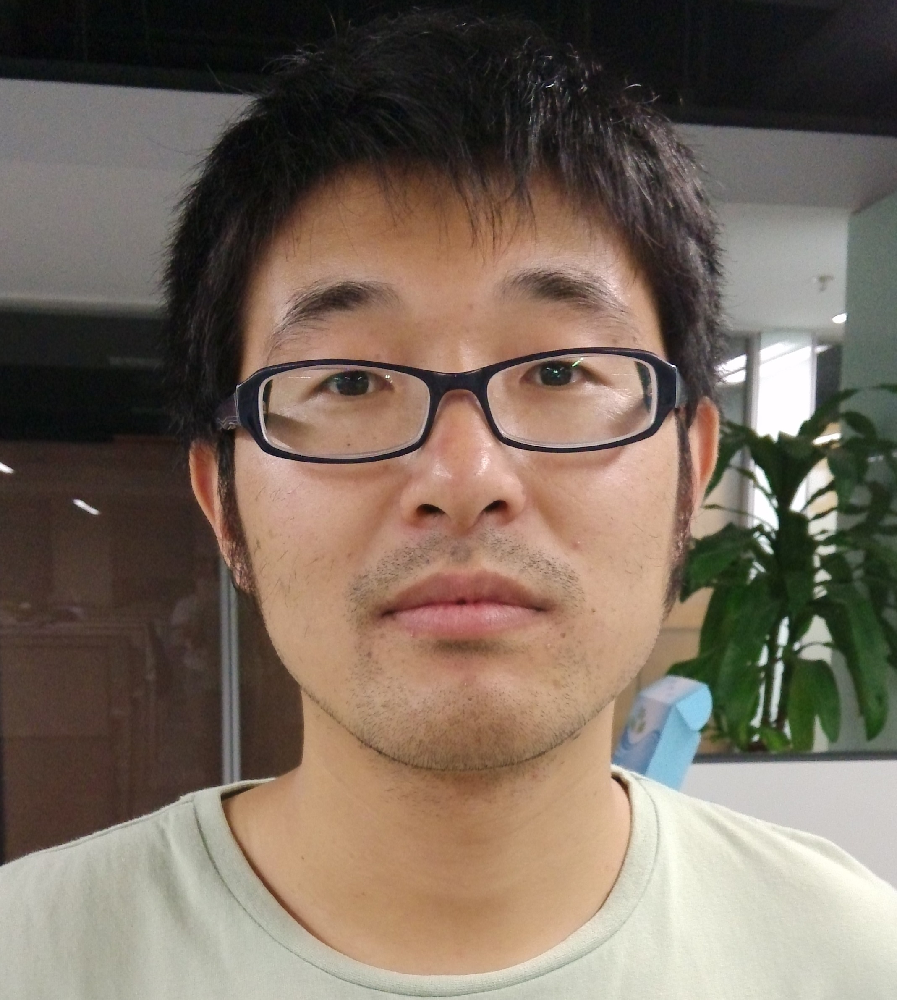

## 👋 Welcome to my homepage!

I am a Professor at State Key Laboratory of Multimodal Artificial Intelligence Systems, Institute of Automation, Chinese Academy of Sciences (CASIA). I received my Doctor’s degree of Pattern Recognition and Intelligent Systems at CASIA. Before that, I received my Master’s degree of Computer Science from Beijing Institute of Technology (BIT). [Curriculum Vitae](Xiaoshan_CV.pdf)
